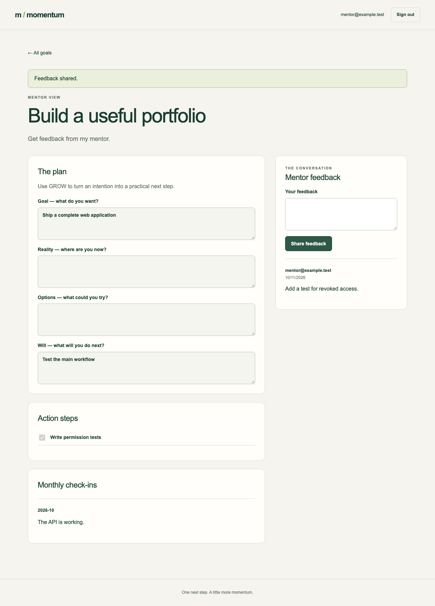

# Momentum

A shared workspace for student goals and mentor feedback.

Students turn a goal into a plan, track small steps and record monthly progress. Mentors see the goals of students who have accepted their invitation and leave feedback. Students keep control of their plans and can remove a mentor’s access at any time.



## Start locally

Requires Node.js 20.19+ and npm on macOS or Linux. Docker and an AWS account are not needed for local development.

```sh
git clone https://github.com/Mingkai406/momentum-project.git
cd momentum-project
npm ci
npm run dev
```

Open **http://127.0.0.1:3000**. The command starts Next.js, Express and a local PostgreSQL instance. Local data stays in `.local/` between runs. Press Ctrl+C to stop all three.

Choose **student** to create a goal. In a separate browser tab, choose **mentor** and invite `student@example.test`. Back in the student workspace, accept the invitation. You can now review the goal and share feedback from the mentor workspace.

These are fictional local accounts, not a public login system. Demo authentication refuses to start in production or on a public interface. Hosted installations use Cognito; see [deployment](docs/DEPLOYMENT.md).

## What you can do

- Create goals and write a GROW plan: Goal, Reality, Options and Will.
- Add action steps and mark them complete.
- Save or revise a monthly check-in.
- Invite students, accept invitations and revoke access.
- Read and respond as a mentor without changing a student’s plan.

Invitations appear inside the student workspace; this version does not send invitation emails. Lists display the latest 200 visible goals.

## How it fits together

```text
apps/web       Next.js · React · TypeScript
apps/api       Express · verified Cognito identity · access checks
 database      PostgreSQL schema (fresh v3 database)
 scripts       local startup, migration and test runners
 tests         API/auth tests and a browser workflow
```

The frontend sends a signed token with every business request. The API verifies its signature, issuer, audience and expiry, then derives the user and role from that identity. Each goal request checks ownership or an accepted mentor relationship. Only the owner can update a plan; only an accepted mentor can leave feedback. Feedback retries use a unique request ID to avoid duplicate entries.

## Check it

```sh
npm run typecheck
npm test
npm run build
npx playwright install chromium
npm run test:e2e
# Or, after installing Chromium:
npm run check
```

API tests use a disposable **real PostgreSQL** database. Browser tests use separate student, mentor and unrelated-student sessions, including a mobile viewport. Cognito tests verify locally signed RSA tokens against a local JWKS; they do not contact a live AWS user pool.

## Project history

Momentum grew out of a Global Student Mentor use case. Its creator reports that an earlier version supported approximately 40 mentees. That is historical use of the earlier application, not adoption of this revision. The former deployment is stopped; this repository does not claim a live public demo.

The frontend and backend were imported from their original repositories and consolidated here. Those repositories remain intact. The separate Go scheduler is not part of this application because it was not connected to the mentorship workflow.

See [source provenance](docs/PROVENANCE.md), [architecture](docs/ARCHITECTURE.md) and [verification](docs/VERIFICATION.md). This revision intentionally uses a fresh database rather than migrating the stopped deployment’s data.
