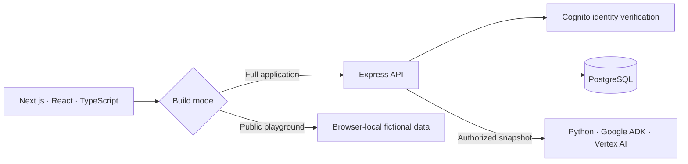

# Momentum

**Goals, progress and mentor feedback in one workspace.**

[Try the live demo →](https://mingkai406.github.io/momentum-project/welcome/) · [Architecture](docs/ARCHITECTURE.md) · [Run locally](#run-the-full-application-locally)

I built Momentum around my work as a Global Student Mentor. An earlier version supported approximately **40 mentees**. This rebuild brings the frontend and backend together and focuses on what happens between mentoring conversations: setting a clear goal, following through on small steps, and knowing when to ask for help.


## Take a look

The [public demo](https://mingkai406.github.io/momentum-project/welcome/) opens without an account. Choose **student** to explore a populated workspace, or **mentor** to read plans and leave feedback. Try creating a goal, completing a step and recording a check-in, then switch roles to see the other side.

The demo uses fictional examples stored in your browser. Changes survive a refresh; **Reset demo** restores the examples. It does not create real accounts, synchronize across devices or contact the backend. The approximately 40 mentees belong to the earlier application, not this public demo.

## The workflow

| Workspace              | What it makes easier                                                                 |
| ---------------------- | ------------------------------------------------------------------------------------ |
| **Overview**           | See goals, completed steps, upcoming actions and recent conversations together.      |
| **Goals**              | Search and filter goals, then open the plan, action steps or monthly check-ins.      |
| **Mentors / Students** | Invite a student, accept a connection and remove access when it is no longer needed. |
| **Updates**            | Find the latest check-ins and mentor feedback without opening every goal.            |

A student's plan uses **GROW**: Goal, Reality, Options and Will. Students own their plans and progress records. Mentors can read and respond after the student accepts their invitation, but cannot rewrite the student's work.


<details>
<summary>Mobile view</summary>
<br />

</details>

## Mentor follow-up assistant

In the connected application, a mentor can prepare a source-linked progress summary and editable feedback from an accepted student's goal. A Google ADK agent reads a bounded goal snapshot through read-only tools. **Nothing is shared until the mentor reviews and confirms it.** The API rechecks access and the goal revision before writing feedback; retries cannot post it twice.

The optional Python service uses Vertex AI. Without a configured project, manual feedback works as before. The public playground does not call a model. [Setup, permissions, tracing and evaluation →](docs/FOLLOWUP_AGENT.md)

## Engineering

The public playground and the full application share the same Next.js interface. The playground uses a browser-only data adapter; the full application sends authenticated requests to Express and PostgreSQL.



- **Authorization at the API boundary.** Each goal request checks its owner or an accepted mentor relationship. Roles come from verified identity, not a field submitted by the browser. The overview applies the same visibility rules to counts and recent activity.
- **Predictable writes.** Monthly check-ins and GROW plans use atomic upserts. Feedback uses a request ID so a retried submission does not create a second comment. Schema application runs in a transaction under an advisory lock.
- **Permission tests with real storage.** Integration tests use disposable PostgreSQL, including access revocation, cross-account writes, concurrent feedback retries and persistence across a database restart.
- **Browser journeys.** The full-app test uses independent student, mentor and unrelated-student sessions. Playground tests cover editing, role switching, browser isolation, reset, keyboard focus and three viewport sizes.

| Layer                       | Technology                                         |
| --------------------------- | -------------------------------------------------- |
| Web                         | Next.js 15, React 19, TypeScript, responsive CSS   |
| API                         | Node.js, Express 5, Zod, parameterized SQL         |
| Storage                     | PostgreSQL                                         |
| Hosted identity integration | Amazon Cognito, verified JWTs                      |
| Tests                       | Node test runner, Supertest, Playwright / Chromium |
| Public hosting              | GitHub Pages, static export, GitHub Actions        |

## Run the full application locally

Requires Node.js 20.19+ and npm on macOS or Linux. No Docker or AWS account is needed for the local workflow.

```sh
git clone https://github.com/Mingkai406/momentum-project.git
cd momentum-project
npm ci
npm run dev
```

Then open `http://127.0.0.1:3000` **on the same computer**. This address works only while the local server is running. For a shareable website, use the live demo link above.

One command starts Next.js, Express and PostgreSQL. Data stays in the ignored `.local/` directory between runs. Ctrl+C stops all three. To try a real API-backed mentoring flow:

1. Choose **student**, create a goal and add a step.
2. Open a separate tab, choose **mentor**, and invite `student@example.test` under **Students**.
3. Return to the student tab, reload **Mentors**, and accept the invitation.
4. Reload the mentor's goal list, open the goal and leave feedback.
5. Remove the connection as the student and verify that the mentor can no longer open the goal.

Local accounts are fictional and use signed, short-lived tokens. The API refuses local demo authentication on a public interface or in production. Real hosted accounts use the Cognito integration described in [deployment](docs/DEPLOYMENT.md).

## Run checks

```sh
npx playwright install chromium
npm run check          # types, API/auth, production build, full-app browser journey
npm run build:preview  # static site for the public demo
npm run test:preview   # demo behavior and responsive checks
npm run format:check
```

GitHub Actions verifies the full application and tests the static export before publishing it. See [verification results](docs/VERIFICATION.md) for scope and limitations.

## Repository map

```text
apps/web/       Interface, authentication client and public demo adapter
apps/api/       Express routes, authorization and database access
 database/      PostgreSQL schema
 scripts/       Local startup, migration, test and export runners
 services/followup/  Optional Python ADK service and fictional evaluation cases
 tests/         API/auth, ADK, full-app browser and public-demo tests
 docs/          Architecture, deployment, provenance and screenshots
```

The original frontend and backend repositories were imported with their history recorded here; they remain available separately. The standalone Go scheduler was not connected to this workflow and is excluded from the rebuild. [Source provenance →](docs/PROVENANCE.md)

Current limits: invitations appear in the app without sending email; goal lists show up to 200 records; the public site is a browser-local demo. Hosting the real backend, configuring a live Cognito pool and arranging backups are separate deployment steps. The old AWS deployment remains stopped.
