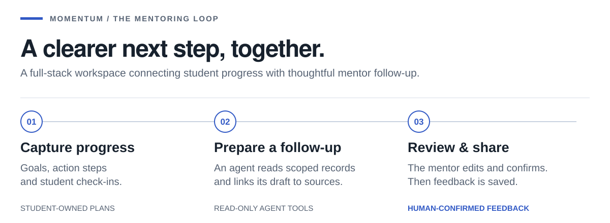
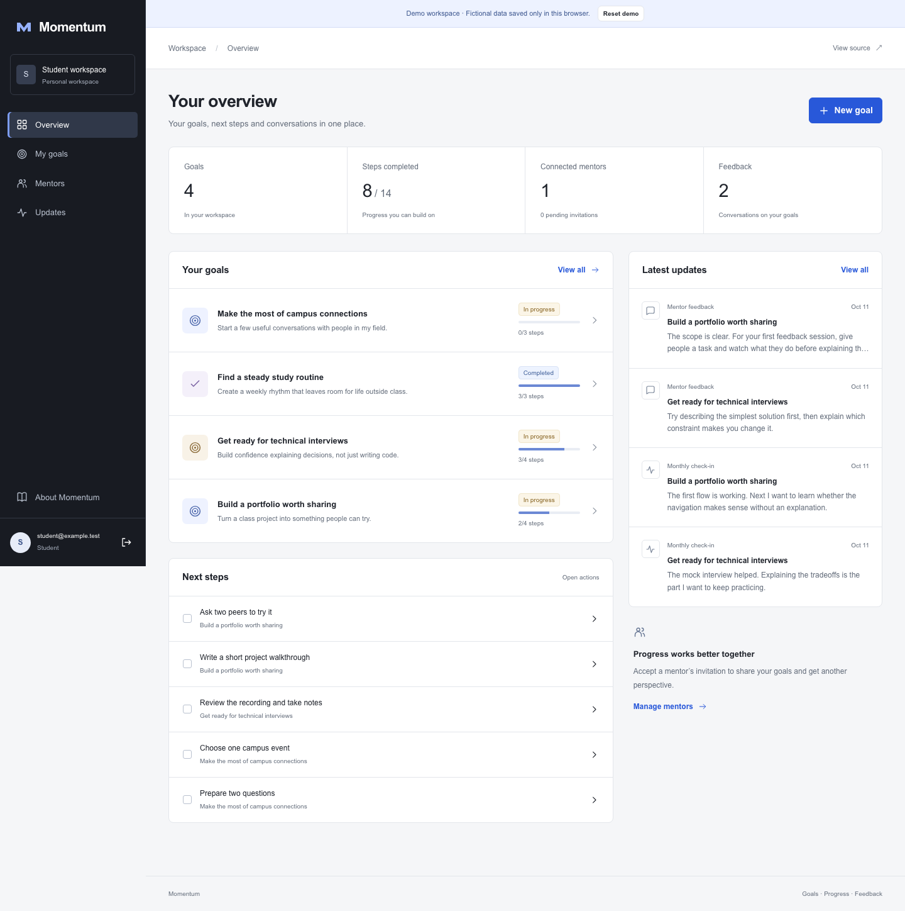
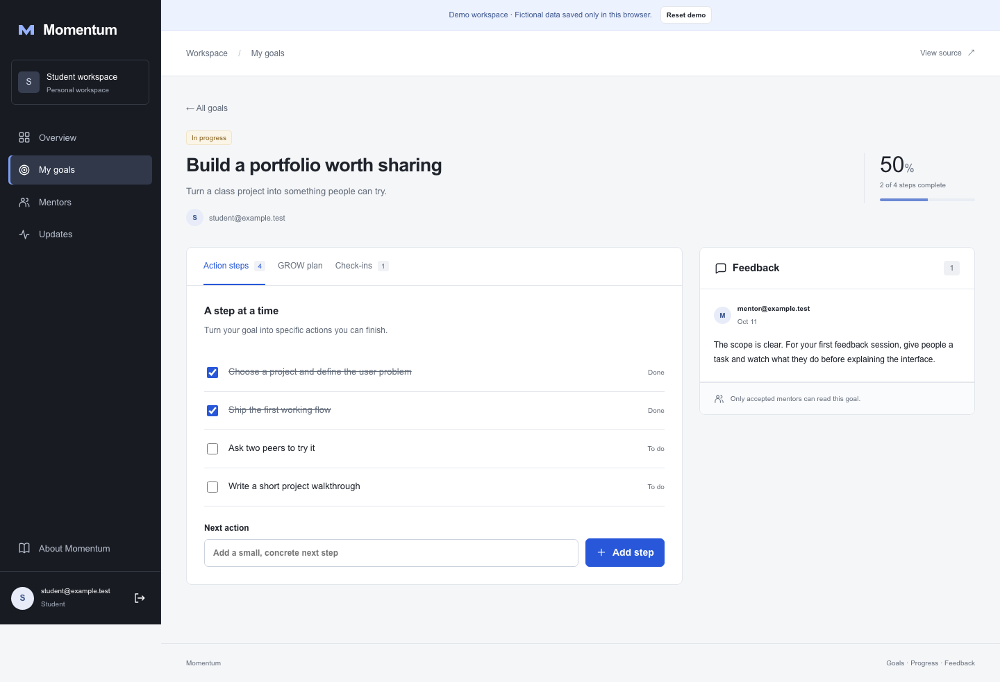
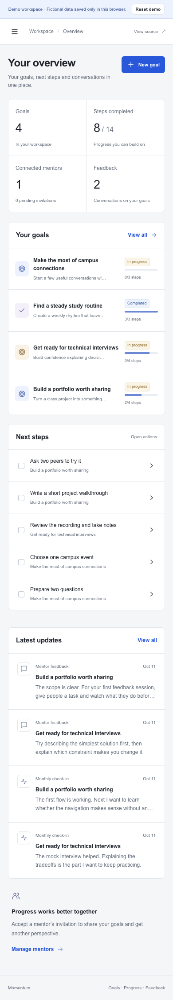
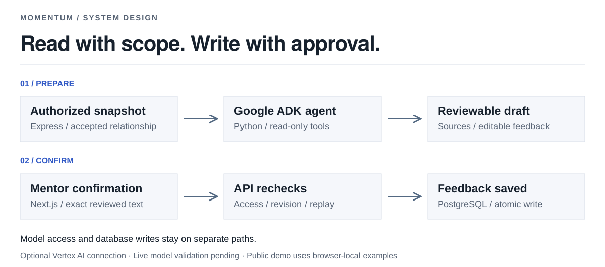

# Momentum

### A full-stack mentoring platform with an AI follow-up assistant.

[**Explore the demo ↗**](https://mingkai406.github.io/momentum-project/welcome/) · [Agent workflow](#from-progress-to-a-useful-follow-up) · [Engineering](#engineering) · [Run locally](#run-locally)



## Built around a real mentoring need

Between mentoring conversations, students need a clear next step and mentors need a way to see what has changed. I built Momentum to address that task-tracking and follow-up problem while serving as a mentor in **Northeastern University's OGS Global Student Mentor Program**. The project supported **40+ students** in that program.

Momentum brings goals, GROW plans, action steps, check-ins and feedback into one workspace. The new mentor assistant adds source-linked progress summaries and editable follow-up drafts, with the mentor deciding what gets shared.

## See the workspace

[](https://mingkai406.github.io/momentum-project/welcome/)

**Student view:** set a goal, break it into steps and record progress. **Mentor view:** follow an accepted student's plan and respond alongside the work.

The public demo opens without signup and uses fictional data saved in your browser. Try creating a goal, completing a step and switching roles; **Reset demo** restores the examples.

<details>
<summary><strong>Goal detail and mobile view</strong></summary>





</details>

## From progress to a useful follow-up

The assistant works on one student's goal at a time. It reads the plan, steps, check-ins and previous feedback, then prepares observations and suggested next steps with links to the underlying records.

| Prepare                                                                     | Review                                                            | Share                                                                           |
| --------------------------------------------------------------------------- | ----------------------------------------------------------------- | ------------------------------------------------------------------------------- |
| A Google ADK agent reads a server-authorized snapshot through scoped tools. | The mentor checks source records and edits the proposed feedback. | Explicit confirmation saves the reviewed text in the student's feedback thread. |

**The agent cannot rewrite a student's plan or publish feedback on its own.** If records change or access is revoked, the API rejects the pending draft. Repeated confirmation saves a single feedback entry.

[Agent setup, tracing and evaluation →](docs/FOLLOWUP_AGENT.md)

> **Try-it status:** the public demo covers the core mentoring workflow. AI generation requires the optional Python service and a configured Vertex AI project; real model validation is pending. The 40+ students reflect use of the mentoring application before this Agent addition.

## Engineering



| Design choice                  | What it protects or enables                                                                                  |
| ------------------------------ | ------------------------------------------------------------------------------------------------------------ |
| **Relationship-based access**  | Only an accepted mentor can read a student's goal; drafts remain private to the mentor who created them.     |
| **Versioned context**          | Changes to plans, steps, check-ins or feedback invalidate pending drafts.                                    |
| **Transactional confirmation** | Access and revision checks happen with the write; concurrent retries return the same feedback.               |
| **Bounded agent execution**    | Read-only tools, strict output validation, known source IDs, call budgets and timeouts.                      |
| **Metadata-only tracing**      | A shared trace ID connects API events, model calls and tools without logging student notes or feedback text. |

The interface and API remain independently usable without the assistant. Manual feedback continues to work if generation is unavailable.

| Layer             | Implementation                                            |
| ----------------- | --------------------------------------------------------- |
| Interface         | Next.js 15 · React 19 · TypeScript                        |
| Backend           | Node.js · Express 5 · Zod                                 |
| Data and identity | PostgreSQL · Amazon Cognito JWT verification              |
| Agent service     | Python · FastAPI · Google ADK · Vertex AI integration     |
| Observability     | OpenTelemetry spans · structured event logs               |
| Verification      | Node test runner · Supertest · pytest · Playwright        |
| Public demo       | GitHub Pages · static export · browser-local example data |

[Application architecture](docs/ARCHITECTURE.md) · [Agent architecture and boundaries](docs/FOLLOWUP_AGENT.md#data-and-authority-boundaries) · [Deployment](docs/DEPLOYMENT.md)

## Verified workflows

**22 API/auth tests · 11 Python/ADK tests · 4 browser tests** passed in the documented local run. GitHub CI also passed the application and Agent suites.

Coverage includes cross-account isolation, revoked access, changing records, expired drafts, concurrent confirmation, provider failures and the existing student/mentor workflow. Python tests execute the real ADK Runner with a scripted model; browser Agent tests use an explicitly labeled service fixture. A **20-case fictional evaluation set** is ready for live model testing.

[Verification report and limits →](docs/VERIFICATION.md)

## Run locally

Node.js **20.19+** and npm, on macOS or Linux:

```sh
git clone https://github.com/Mingkai406/momentum-project.git
cd momentum-project
npm ci
npm run dev
```

Open **http://127.0.0.1:3000** on that computer. One command starts the frontend, API and PostgreSQL with fictional local accounts. Local data persists in the ignored `.local/` directory. No AWS or GCP account is needed for the core workflow.

<details>
<summary><strong>Walk through student and mentor access</strong></summary>

1. Choose **student**, create a goal and add a step.
2. In a separate tab, choose **mentor** and invite `student@example.test` under **Students**.
3. Return to the student's **Mentors** page and accept the invitation.
4. Reload the mentor's goals, open the goal and leave feedback.
5. Remove the connection as the student to revoke the mentor's access.

Local sign-in is restricted to development on loopback. Hosted accounts use Cognito. The local address is not a public website; use the demo link to explore without installing anything.

</details>

**Connect the assistant:** install the optional Python service and configure a personal Vertex AI project using the [Agent setup guide](docs/FOLLOWUP_AGENT.md#local-service-setup).

<details>
<summary><strong>Run the checks</strong></summary>

```sh
npx playwright install chromium
npm run check
npm run test:agent:browser
npm run build:preview
npm run test:preview
npm run format:check
```

After installing the Python dependencies described in the setup guide:

```sh
PYTHONPATH=services/followup .venv-agent/bin/python -m pytest tests/agent -q
```

The live-model evaluation is separately opt-in and requires cloud credentials.

</details>

## Explore the source

```text
apps/web/           Interface, authentication client and demo adapter
apps/api/           Authenticated routes, permissions and confirmation
services/followup/  ADK tools, model service, tracing and evaluation cases
database/           PostgreSQL schema and migrations
tests/              API, agent and browser coverage
docs/               Architecture, setup, verification and screenshots
```

The frontend and backend are consolidated here; the original repositories remain available. [Repository provenance](docs/PROVENANCE.md). Invitations currently appear in-app without email delivery. The public site uses local example data; hosted accounts and the AI backend are not deployed there.

<sub>Visual direction: typography and restrained annotations inspired by <a href="https://hrbrmstr.github.io/hrbrthemes/">hrbrthemes / theme_ipsum</a>, selected from the <a href="https://exts.ggplot2.tidyverse.org/gallery/">ggplot2 extension gallery</a>. Diagrams are original SVGs; interface images are Momentum screenshots with fictional data.</sub>
